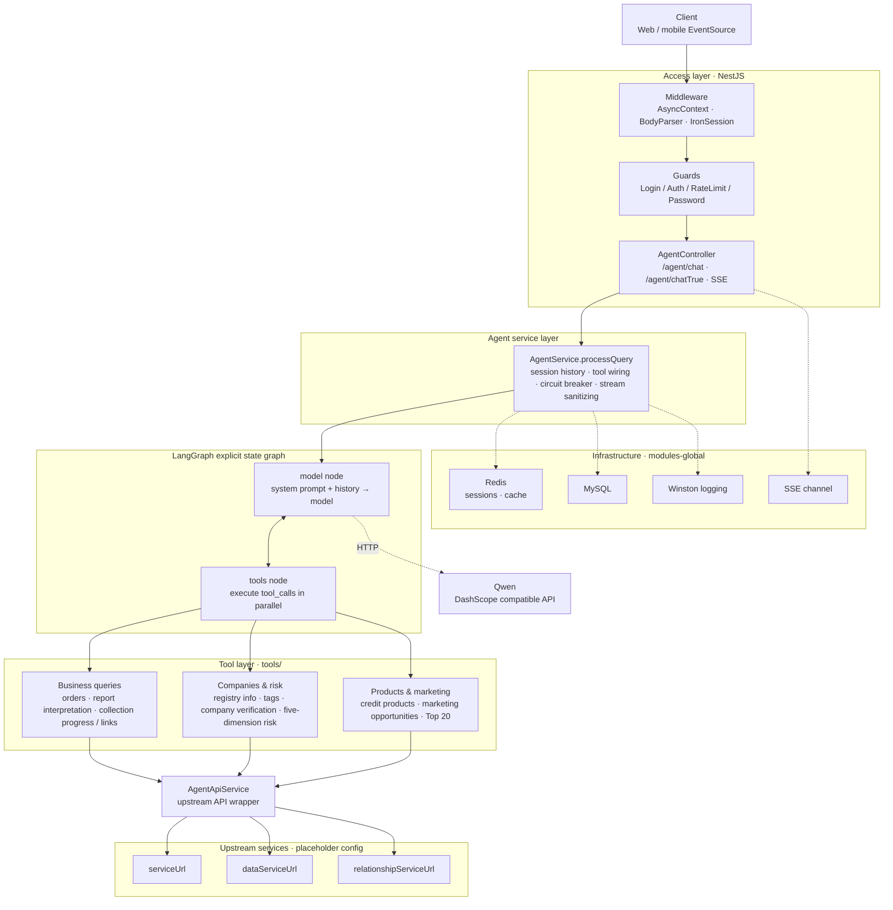
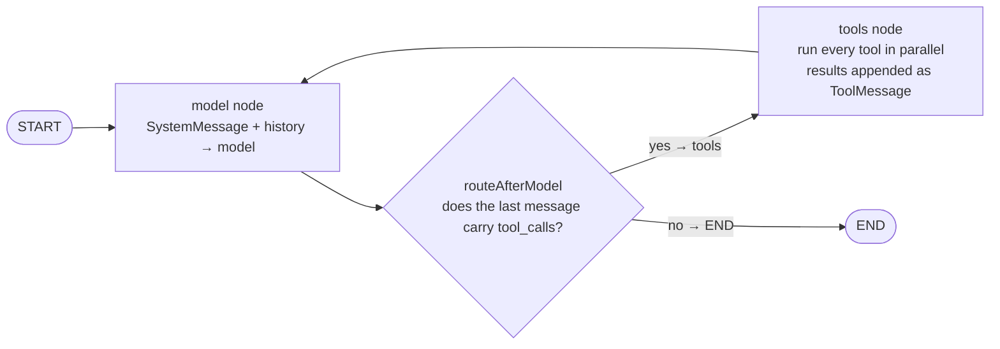
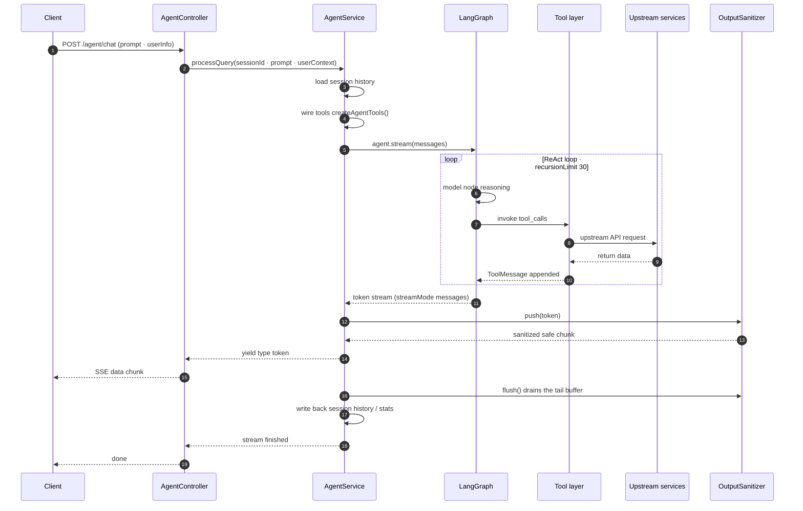

# Enterprise Business Advisor Agent — NestJS 11 + TypeScript (ReAct)

[中文](README.md) | **English**

A **ReAct (Reasoning + Acting)** agent backend built on **LangGraph / LangChain**. The agent
interprets user intent by itself and dynamically selects and composes tools — with no
predefined intent classification — streaming its reasoning and tool calls over SSE.

> This repository is a **desensitized public release**: all company identifiers, internal
> domains, keys and institution numbers, as well as the organizations and individuals in the
> sample data, have been replaced with neutral placeholders or fictional values. The default
> configuration cannot reach any real backend — it is intended for code reading and local
> demos only.

## Documentation

| Document | Contents |
| --- | --- |
| `README.md` (this file) | Project overview, system architecture, API, project structure, quick start |
| [`REACT_AGENT_README.md`](REACT_AGENT_README.md) | In-depth ReAct design notes: node decomposition, writing tools, debugging, and a comparison with the legacy "18 predefined intents" workflow implementation |

## Features

- **Autonomous decisions** — the agent decides whether to call a tool and which one, and can compose multiple tools for complex tasks
- **Natural-language understanding** — no keyword matching; multi-turn conversation with context memory
- **Tool-driven** — tool descriptions teach the LLM when to call them; adding a tool requires no change to the core logic
- **Streaming output** — SSE shows the answer and the tool-call process in real time
- **Session management** — multi-turn session state with per-session statistics

## Tech Stack

| Area | Choice |
| --- | --- |
| Runtime | Node.js 18+ / NestJS 11 / TypeScript 5 |
| Agent | `@langchain/langgraph`, `@langchain/core`, `langchain` |
| Model | Qwen (Tongyi Qianwen) family, via the Alibaba Cloud DashScope OpenAI-compatible API |
| Storage | Redis (ioredis), MySQL (mysql2 / Prisma Client) |
| Infrastructure | Winston logging, SSE, Axios, iron-session, zod |

## Quick Start

```bash
npm install

# copy the sample env file and adjust as needed
cp .env.example .env

npm run dev            # dev mode (watch, PRODUCT_ENV=dev)
```

The server listens on `server.port` from `config.dev.yaml` (default `8025`).

### Common scripts

```bash
npm run build          # compile TypeScript to dist/
npm run start:prod     # run with production config (PRODUCT_ENV=prod)
npm run lint           # ESLint with autofix
npm run format         # Prettier formatting
npm test               # Jest unit tests
```

## Configuration

Configuration is split per environment as YAML files: `config.dev.yaml`, `config.test.yaml`
(extendable with `config.pre.yaml`, `config.prod.yaml`), selected by the `PRODUCT_ENV`
environment variable, loaded through `getConfig()` in `src/config/index.ts`.

Using `config.dev.yaml` as an example, these are the fields you need to adapt:

```yaml
server:
  host: 'localhost'
  port: 8025

redis:
  host: 'redis-pool.test.example.com'
  port: 6379
  password: 'YOUR_REDIS_PASSWORD'

agent:
  SERVICE_URL: 'https://www-pre.example.com'   # upstream business service
  DATA_SERVICE_URL: 'http://data.middle.example.com/databusi'
  AGENT_MODEL_NAME: 'qwen3-max'
  AGENT_API_KEY: 'sk-REPLACE_WITH_YOUR_API_KEY'
  AGENT_BASE_URL: 'https://dashscope.aliyuncs.com/compatible-mode/v1'
  AGENT_TEMPERATURE: 0.5
  AGENT_MAX_TOKENS: 50000

mysql:
  host: 'localhost'
  port: 3306
  user: 'root'
  password: 'YOUR_DB_PASSWORD'
  database: 'rpa_institution_channel'
```

> In the repository's `config.*.yaml` files, all domains, keys, institution numbers and
> session cookies are placeholders. Inject real credentials through environment variables or
> a local private config — **never** commit real secrets.

## Architecture

### System architecture



### The ReAct loop (an explicit LangGraph graph)

See `graph/react-agent.ts` — instead of the `createAgent()` wrapper, the graph is assembled by
hand with `StateGraph`, where the `model` ⇄ `tools` nodes are driven by the conditional edge
`routeAfterModel`:

> 📄 For the full ReAct design notes (node decomposition, writing tools, debugging, and a
> comparison with the legacy "18 predefined intents" workflow), see
> **[REACT_AGENT_README.md](REACT_AGENT_README.md)**.



A single query's ReAct loop is bounded by `recursionLimit: 30`; `agent.service.ts` adds a
further circuit breaker (at most 15 tool calls per query, at most 3 per individual tool) to
keep the model from looping forever.

### Streaming path of one request



> The sanitizer keeps a tail buffer and withholds the last few characters (so identifiers are
> never split across a chunk boundary), which means `push()` may return an empty string.
> `flush()` drains the remainder when the stream ends and closes any unclosed tags. On
> "stop generating", `flush()` still runs so nothing at the tail is lost.

### Core agent module `src/modules/agent/`

| File | Responsibility |
| --- | --- |
| `graph/react-agent.ts` | Builds the ReAct loop explicitly with the LangGraph `StateGraph` (`model` ⇄ `tools` nodes plus a conditional edge) |
| `graph/state.ts` | Graph state definition: an append-style `messages` reducer plus `userContext` |
| `prompts/system-prompt.ts` | LLM system prompt |
| `output/output-sanitizer.ts` | Output sanitizing: tool / field names → business terms, tag-closing repair, streaming-safe (see below) |
| `output/glossary.ts` | Glossary for output sanitizing (tool names, field names, the whitelist of tags that must be paired) |
| `tools/index.ts` | Tool factory aggregating all available tools |
| `tools/*.tool.ts` | Individual business tools (order lookup, report interpretation, collection progress / links, company verification, product matching, marketing opportunities, WeCom follow-up, etc.) |
| `session/session.manager.ts` | Multi-turn session management |
| `api.service.ts` | Upstream service API wrapper |
| `config/agent.config.ts` | Agent config (model, temperature, tokens, knowledge base) |

### Output sanitizing `src/modules/agent/output/`

The P0 rules in the system prompt (never expose field names; tags must be closed) used to rely
on the model's own compliance. Here, deterministic code backs them up — turning "I hope the
model doesn't write that" into "even if the model writes it, it gets rewritten":

- **Term replacement**: tool names / field names → Chinese business terms (the glossary in
  `glossary.ts` holds 27 tool names + 145 field names + 7 internal protocol words)
- **Tag-closing repair**: `<go />` → `<go></go>`, and unclosed tags are closed when the stream ends
- **Phrasing cleanup**: removes technical wording such as "data source: X" or "according to the data returned by tool X,"

The sanitizer is **streaming-safe**. As the model emits token by token, `taxCreditRating` can be
split into `taxCred` + `itRating`, and `</line>` into `</li` + `ne>`; once split, glossary
matching and tag pairing both break. So a tail buffer is maintained internally: `push()` only
releases content up to a safe split point (a three-way fallback over tag boundaries / identifier
boundaries / phrasing anchors), and `flush()` drains what remains.

The inside of `<...>` tags (including attributes) is never sanitized, so protocol attributes
required for front-end rendering — such as `<g3 corpname="..." creditno="...">` — and tags that
must pass through verbatim, such as `qrcode` / `report-card` / `generatereport`, are left
untouched.

### Global modules `src/modules-global/`

`redis/` · `http/` · `logger/` · `sse/` · `async-context/` · `utils/` · `cache/`

### Request lifecycle

- Middleware (in order): `moduleRef` injection → `AsyncContextMiddleware` → `JsonBodyParser` +
  `UrlEncodedBodyParser` → `FilterMiddleware` → `IronSessionMiddleware` (all excluding `api/proxy/*path`)
- Guards: `LoginGuard`, `AuthGuard`, `RateLimitGuard`, `PasswordGuard`
- Interceptors: `InvokeRecordInterceptor` (logging), `FormatResponseInterceptor` (uniform response envelope)

## Project structure

```
src/
├── config/                 # config loading
├── guards/  interceptor/  middleware/  decorator/
├── modules/
│   ├── agent/              # ReAct agent core
│   │   ├── graph/  prompts/  session/  tools/  output/
│   │   ├── services/       # auth, report formatting, file upload, etc.
│   │   └── static/         # sample report data (fictionalized)
│   ├── ai/  upload/  yzm/
├── modules-global/         # redis / http / logger / sse / ...
├── mock/                   # sample data (fictionalized)
├── types/  utils/
```

## API

### `POST /agent/chat`

Streaming SSE conversation with the agent.

```json
{
  "prompt": "What orders do I have?",
  "orgNo": "ORG0000000000000000A",
  "orgChannelNo": "OC000000000000000000",
  "orgChannelUserId": 15,
  "session": "session=YOUR_SESSION_COOKIE"
}
```

The response is `text/event-stream`, returning content segment by segment:

```
data: {"content":"You"}
data: {"content":"have"}
...
```

### `POST /agent/stats`

Returns session statistics.

## Adding a tool

1. Create `src/modules/agent/tools/your-tool.tool.ts`, exporting a factory that returns a
   `DynamicStructuredTool` (with a zod schema)
2. Register and export it in the `createAgentTools` array in `src/modules/agent/tools/index.ts`
3. Done — the agent learns to use it from the tool description alone; no routing changes needed

```typescript
import { DynamicStructuredTool } from '@langchain/core/tools';
import { z } from 'zod';

export function createYourTool(httpService, userContext, serviceUrl) {
  return new DynamicStructuredTool({
    name: 'your_tool',
    description: 'Detailed description of the tool, when to use it, and what it returns',
    schema: z.object({
      param1: z.string().describe('Parameter description'),
    }),
    func: async (input) => {
      return 'tool result';
    },
  });
}
```

## Development conventions

- TypeScript strict mode; ESLint (`@typescript-eslint` + Prettier)
- `@typescript-eslint/no-explicit-any` is disabled, so `any` is allowed
- Modules follow the NestJS structure: `module.ts` / `service.ts` / `controller.ts` / `dto/`
- Path aliases start with `src/` (e.g. `import { X } from 'src/modules-global/...'`)
- Code comments are written in Chinese

## About the sample data

The sample data under `src/mock/` and `src/modules/agent/static/` is used for local demo report
rendering. In it:

- Company names, unified social credit codes, registration numbers, addresses, contacts, phone
  numbers and ID numbers are **all fictional placeholders**
- Financial and invoice figures are illustrative only and do not represent any real entity

## Disclaimer

This project is provided "as is" and does not constitute any investment, credit or legal advice.
Evaluate it yourself and comply with the laws, regulations and data-compliance requirements of
your jurisdiction before use.

## License

[MIT](LICENSE)
