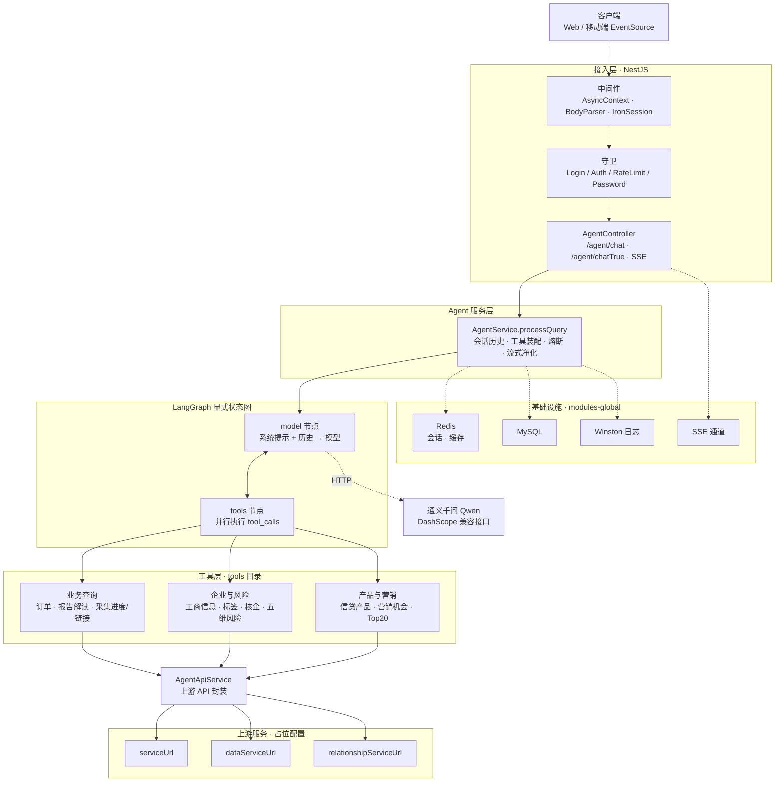
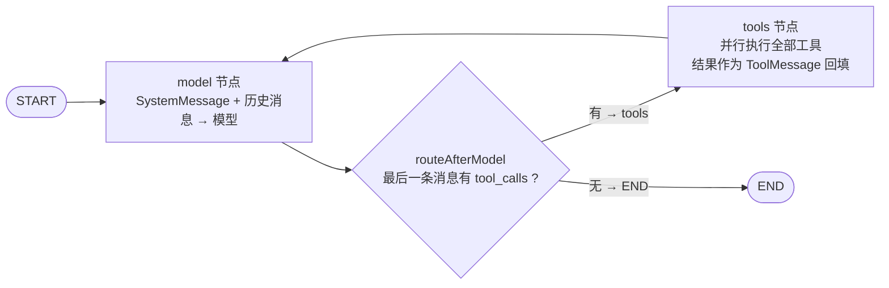
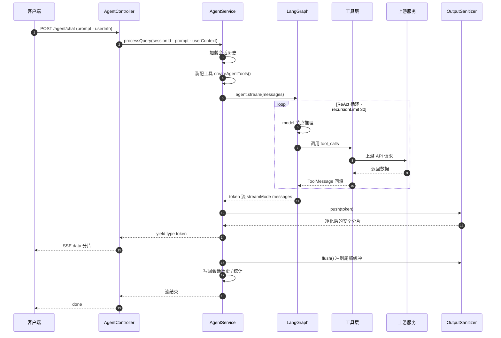

# NestJS 11 + TypeScript 企业业务顾问智能体（ReAct Agent）

**中文** | [English](README.en.md)

基于 **LangGraph / LangChain** 的 ReAct（Reasoning + Acting）智能体后端服务。Agent 自主理解用户意图、
动态选择并组合工具，无需预定义意图分类，通过 SSE 流式输出推理与工具调用过程。

> 本仓库为**脱敏后的公开版本**：所有公司标识、内部域名、密钥、机构号以及示例数据中的企业与个人信息
> 均已替换为中性占位符或虚构数据。默认配置无法连接任何真实后端，仅用于代码阅读与本地演示。

## 文档

| 文档 | 内容 |
| --- | --- |
| `README.md`（本文） | 项目总览、系统架构、API、目录结构、快速开始 |
| [`REACT_AGENT_README.md`](REACT_AGENT_README.md) | ReAct Agent 设计详解：节点拆分、工具编写、调试方法，以及与旧「18 种预定义意图」工作流实现的对比 |

## 特性

- **自主决策**：Agent 自行判断是否需要调用工具、调用哪个工具，可组合多工具完成复杂任务
- **自然语言理解**：不依赖关键词匹配，支持多轮对话与上下文记忆
- **工具驱动**：通过工具描述让 LLM 理解何时调用；新增工具无需改动核心逻辑
- **流式输出**：基于 SSE 实时展示回答与工具调用过程
- **会话管理**：多轮会话状态维护，支持会话级统计

## 技术栈

| 分类 | 选型 |
| --- | --- |
| 运行时 | Node.js 18+ / NestJS 11 / TypeScript 5 |
| 智能体 | `@langchain/langgraph`、`@langchain/core`、`langchain` |
| 模型 | 通义千问（Qwen）系列，经阿里云 DashScope OpenAI 兼容接口调用 |
| 存储 | Redis（ioredis）、MySQL（mysql2 / Prisma Client） |
| 基础设施 | Winston 日志、SSE、Axios、iron-session、zod |

## 快速开始

```bash
npm install

# 复制示例环境变量并按需修改
cp .env.example .env

npm run dev            # 开发模式（watch，PRODUCT_ENV=dev）
```

服务默认监听 `config.dev.yaml` 中的 `server.port`（默认 `8025`）。

### 常用脚本

```bash
npm run build          # 编译 TypeScript 到 dist/
npm run start:prod     # 以生产配置运行（PRODUCT_ENV=prod）
npm run lint           # ESLint 自动修复
npm run format         # Prettier 格式化
npm test               # Jest 单元测试
```

## 配置

配置按环境拆分，采用 YAML 文件：`config.dev.yaml`、`config.test.yaml`（可扩展 `config.pre.yaml`、
`config.prod.yaml`），通过 `PRODUCT_ENV` 环境变量选择，入口为 `src/config/index.ts` 的 `getConfig()`。

以 `config.dev.yaml` 为例，需要按你的环境调整的字段：

```yaml
server:
  host: 'localhost'
  port: 8025

redis:
  host: 'redis-pool.test.example.com'
  port: 6379
  password: 'YOUR_REDIS_PASSWORD'

agent:
  SERVICE_URL: 'https://www-pre.example.com'   # 上游业务服务地址
  DATA_SERVICE_URL: 'http://data.middle.example.com/databusi'
  AGENT_MODEL_NAME: 'qwen3-max'
  AGENT_API_KEY: 'sk-REPLACE_WITH_YOUR_API_KEY'
  AGENT_BASE_URL: 'https://dashscope.aliyuncs.com/compatible-mode/v1'
  AGENT_TEMPERATURE: 0.5
  AGENT_MAX_TOKENS: 50000

mysql:
  host: 'localhost'
  port: 3306
  user: 'root'
  password: 'YOUR_DB_PASSWORD'
  database: 'rpa_institution_channel'
```

> 仓库内的 `config.*.yaml` 中，所有域名、密钥、机构号、会话 Cookie 均为占位符。
> 请通过环境变量或本地私有配置注入真实凭据，**不要**把真实密钥提交到仓库。

## 架构

### 系统架构



### ReAct 循环（显式 LangGraph 图）

对应 `graph/react-agent.ts` —— 不用 `createAgent()` 封装，而是用 `StateGraph` 手工搭建，
`model` ⇄ `tools` 两个节点由条件边 `routeAfterModel` 驱动：

> 📄 完整的 ReAct 设计说明（节点拆分、工具编写、调试方法，以及与旧「18 种预定义意图」工作流的对比）
> 见 **[REACT_AGENT_README.md](REACT_AGENT_README.md)**。



单次查询的 ReAct 循环受 `recursionLimit: 30` 限制；`agent.service.ts` 另有熔断
（单次查询工具调用总数 ≤ 15、同一工具 ≤ 3 次），防止模型陷入无限循环。

### 一次请求的流式链路



> 净化器内部的尾部缓冲会扣留末尾若干字符（防标识符被 chunk 边界切断），因此
> `push()` 可能返回空串；`flush()` 在流结束时冲刷剩余内容并补全未闭合标签。
> 「停止生成」时 `flush()` 仍会执行，避免丢尾巴。

### 核心 Agent 模块 `src/modules/agent/`

| 文件 | 职责 |
| --- | --- |
| `graph/react-agent.ts` | 用 LangGraph `StateGraph` 显式搭建 ReAct 循环（`model` ⇄ `tools` 节点 + 条件边） |
| `graph/state.ts` | 图状态（State）定义：`messages` 追加式 reducer + `userContext` |
| `prompts/system-prompt.ts` | LLM 系统提示词 |
| `output/output-sanitizer.ts` | 输出净化：工具名/字段名 → 业务术语、标签闭合修复，流式安全（见下） |
| `output/glossary.ts` | 输出净化术语词典（工具名、字段名、需配对的标签白名单） |
| `tools/index.ts` | 工具工厂，聚合全部可用工具 |
| `tools/*.tool.ts` | 各业务工具（订单查询、报告解读、采集进度/链接、企业核验、产品匹配、营销机会、企微关注等） |
| `session/session.manager.ts` | 多轮会话管理 |
| `api.service.ts` | 上游服务 API 封装 |
| `config/agent.config.ts` | Agent 配置（模型、温度、Token、知识库） |

### 输出净化 `src/modules/agent/output/`

系统提示词里的 P0 规则（禁止暴露字段名、标签必须闭合）原本只靠模型自觉遵守，
这里用确定性代码做兜底，把"希望模型别这么写"变成"模型写了也会被改掉"：

- **术语替换**：工具名 / 字段名 → 中文业务术语（词表见 `glossary.ts`，27 个工具名 + 145 个字段名 + 7 个内部协议词）
- **标签闭合修复**：`<go />` → `<go></go>`，流结束时补全未闭合标签
- **话术清理**：删除"数据来源：X""根据X工具返回的数据，"这类技术表述

净化器是**流式安全**的。模型逐 token 输出时，`taxCreditRating` 可能被切成
`taxCred` + `itRating`，`</line>` 可能被切成 `</li` + `ne>`；一旦被切开，词典匹配和标签配对
都会失效。因此内部维护尾部缓冲，`push()` 只放行到安全切分点为止（标签边界 / 标识符边界 /
话术锚点三重回退），`flush()` 冲刷剩余内容。

`<...>` 标签内部（含属性）不参与净化，所以 `<g3 corpname="..." creditno="...">` 这类前端渲染
必需的协议属性、以及 `qrcode` / `report-card` / `generatereport` 等应原样输出的标签都不会被改动。

### 全局模块 `src/modules-global/`

`redis/` · `http/` · `logger/` · `sse/` · `async-context/` · `utils/` · `cache/`

### 请求生命周期

- 中间件（按序）：`moduleRef` 注入 → `AsyncContextMiddleware` → `JsonBodyParser` + `UrlEncodedBodyParser`
  → `FilterMiddleware` → `IronSessionMiddleware`（均排除 `api/proxy/*path`）
- 守卫：`LoginGuard`、`AuthGuard`、`RateLimitGuard`、`PasswordGuard`
- 拦截器：`InvokeRecordInterceptor`（日志）、`FormatResponseInterceptor`（统一响应包装）

## 目录结构

```
src/
├── config/                 # 配置加载
├── guards/  interceptor/  middleware/  decorator/
├── modules/
│   ├── agent/              # ReAct Agent 核心
│   │   ├── graph/  prompts/  session/  tools/  output/
│   │   ├── services/       # 鉴权、报告格式化、文件上传等
│   │   └── static/         # 示例报告数据（已虚构化）
│   ├── ai/  upload/  yzm/
├── modules-global/         # redis / http / logger / sse / ...
├── mock/                   # 示例数据（已虚构化）
├── types/  utils/
```

## API

### `POST /agent/chat`

与 Agent 进行 SSE 流式对话。

```json
{
  "prompt": "我有哪些订单？",
  "orgNo": "ORG0000000000000000A",
  "orgChannelNo": "OC000000000000000000",
  "orgChannelUserId": 15,
  "session": "session=YOUR_SESSION_COOKIE"
}
```

响应为 `text/event-stream`，逐段返回内容：

```
data: {"content":"您"}
data: {"content":"有"}
...
```

### `POST /agent/stats`

返回会话统计信息。

## 新增一个工具

1. 新建 `src/modules/agent/tools/your-tool.tool.ts`，导出返回 `DynamicStructuredTool`（zod schema）的工厂函数
2. 在 `src/modules/agent/tools/index.ts` 的 `createAgentTools` 数组中注册并导出
3. 完成 —— Agent 会依据工具描述自动学会使用它，无需修改路由

```typescript
import { DynamicStructuredTool } from '@langchain/core/tools';
import { z } from 'zod';

export function createYourTool(httpService, userContext, serviceUrl) {
  return new DynamicStructuredTool({
    name: 'your_tool',
    description: '工具的详细描述、使用场景与返回说明',
    schema: z.object({
      param1: z.string().describe('参数说明'),
    }),
    func: async (input) => {
      return '工具执行结果';
    },
  });
}
```

## 开发约定

- TypeScript strict 模式；ESLint（`@typescript-eslint` + Prettier）
- `@typescript-eslint/no-explicit-any` 已关闭，允许使用 `any`
- 模块遵循 NestJS 结构：`module.ts` / `service.ts` / `controller.ts` / `dto/`
- 路径别名以 `src/` 开头（如 `import { X } from 'src/modules-global/...'`）
- 代码注释使用中文

## 关于示例数据

`src/mock/` 与 `src/modules/agent/static/` 下的样例数据用于本地演示报告渲染，其中：

- 企业名称、统一社会信用代码、登记号、地址、联系人、手机号、身份证号等**均为虚构占位值**
- 财务与发票数值仅供参考，不代表任何真实主体

## 免责声明

本项目按「现状」提供，不构成任何投资、信贷或法律建议。使用前请自行评估并遵守所在地法律法规及数据合规要求。

## 许可证

[MIT](LICENSE)
